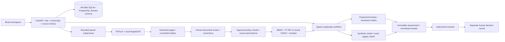
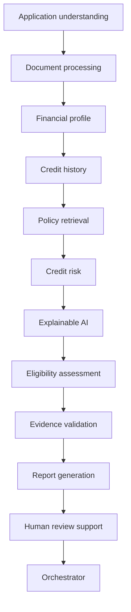

# Architecture

LoanWise separates the React workspace, authorized REST API, relational operational data, isolated extraction/OCR, model artifacts, retrieval and typed LangGraph orchestration. It creates review material and executes no lending transactions.

Each node validates a dedicated Pydantic payload before updating shared state. An AgentOutput envelope records status, warnings and evidence IDs. Nodes are deterministic services/local model calls, not twelve independently connected LLMs. A node retries once; repeated failure records a trace and withholds the final assessment. Executions, durations, outputs and retries persist in SQL. Distributed workers/checkpoint recovery remain deployment hardening options.

## Relational source of truth

Financial profiles relate to typed income, employment, expense, liability, credit-account and repayment records. Documents contain versioned page rows, entities and correction history. Policy configurations have active versions/revisions and criteria linked to exact source pages. Assessments write criterion results, financial features, predictions, prediction features, SHAP contributions and evidence links.

Application.profile, Product.criteria and Document.pages/extraction are compatibility properties, not JSON columns. JSON remains only in immutable rendered assessment, agent and query archives. See [database details](DATABASE.md).

Revision 0001 freezes the legacy schema; 0002 backfills normalized data before removing JSON input columns. SQLite uses explicit transactional DDL and a foreign-key check; PostgreSQL migrations are transactional. The existing 500-applicant local database was backed up and upgraded.

## Extraction and retrieval boundary

Complex formats run in spawned processes with byte/page/pixel/OCR-page/wall-time/RSS limits and bounded concurrency. Unix adds address-space/CPU limits. Async uploads offload parser waiting from the API event loop. Selectable PDF text is retained; blank PDF pages and PNG/JPEG images use local CPU OCR. Page methods and raw recognition scores persist. DOCX uses logical extraction pages.

Corrections preserve source quotes and previous/corrected values with reviewer identity/time. Reviewing a document never silently verifies its extracted financial values or copies them into a profile.

Only reviewed, authorized, effective, current-version policy sources enter shared retrieval. Role permissions filter before keyword/vector scoring. Applicant financial documents are excluded. Reindexing retires chunks rather than deleting citation targets; chunks reference exact page revisions.

The default is BM25 + TF-IDF rank fusion. Optional neural mode uses CPU Sentence Transformers, persisted FAISS and a cross encoder, with remote model code disabled. Relevance scores are not financial certainty. Answers quote source passages or abstain. Applicant context uses authorized current calculations and evidence-checked assessments. Historical answers/traces recheck source permissions; private query context also rechecks current applicant ownership.

## Models, review and security

Five classifiers use seeded synthetic observations, disjoint splits and training-only preprocessing. The logistic baseline is selected before evaluation; SHAP explains its log-odds additively, not causally. Versions/artifacts and applicant prediction/explanation histories are retained. Random synthetic cohorts exercise fairness metrics only; demographic fairness and real-world lending validity remain unevaluated.

Configured policy quotations support criterion comparisons. Unknown values do not satisfy conditions; empty policy configuration yields insufficient information. Every outcome requires human review. Source/profile/configuration changes invalidate stale review inputs. Human decisions are separate records and trigger no financial action.

Sessions are opaque and hashed; passwords use scrypt. Ownership and current role/source permissions are checked on requests. Uploaded text is never instructions to execute. HttpOnly/SameSite cookies, Origin validation, parameter-hiding database errors, bounded uploads/parsers and a development rate limiter support the prototype. TLS, shared rate limits, malware scanning, institutional model governance and broader security/load validation need deployment-specific work. The validation agent does not establish legal compliance.

Compose separates PostgreSQL, backend and Nginx/frontend with persistent volumes and health dependencies. PostgreSQL and the neural path were tested locally. Compose configuration passed, but container build/runtime testing is blocked by the missing Docker engine. Reproducible tests and Linux CI jobs are prepared without claiming those remote jobs ran here.

Vercel's API uses a dedicated parser child module, with JSON over private process pipes and the same timeout/RSS/Unix resource controls, instead of re-executing the host web-server entrypoint. OCR packages use headless OpenCV in a locked deployment dependency set.
