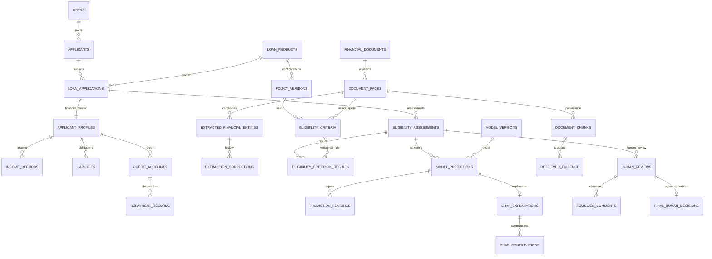

# Relational database design

There are **48 domain tables**, plus Alembic bookkeeping. Mutable financial, policy and document facts are relational; JSON report/agent/query archives are immutable materialized documents.

| Domain | Tables |
|---|---|
| Identity/access | users, sessions, roles, permissions, role_permissions, document_permissions |
| Applicant/loan | applicants, applicant_profiles, loan_products, loan_applications |
| Financial sources | employment_records, income_records, expense_records, liabilities, credit_accounts, repayment_records |
| Documents | financial_documents, document_pages, extracted_financial_entities, extraction_corrections, document_warnings, document_chunks, knowledge_sources |
| Policy/eligibility | policy_documents, policy_versions, eligibility_criteria, eligibility_assessments, eligibility_criterion_results, financial_features |
| Models/explanations | ml_models, model_versions, model_predictions, prediction_features, model_evaluations, calibration_bins, shap_explanations, shap_contributions, fairness_evaluations |
| Retrieval/review/audit | rag_queries, retrieved_evidence, generated_responses, agent_executions, human_reviews, reviewer_comments, final_human_decisions, audit_logs, application_feedback, migration_issues |

## Invariants

- One financial context belongs to one application. Identity is reached through the application; it is not copied into model features.
- Income frequency/amount/verification are explicit. No records means unknown income; an explicit zero liability remains known zero debt.
- Application/source money has fixed precision. Bounds, enum-like checks, unique periods, indexes and foreign keys constrain records.
- Verification flags are declared review state, not independent bureau/bank verification. Protected characteristics are not predictive inputs.
- Financial documents belong to an application; shared policies belong to a product and cannot be attached to a private applicant record.
- Page numbers can have retained extraction revisions. Entities/chunks reference exact page rows. Reindexing retires chunks so old citation IDs survive.
- Corrections retain original quotes and append reviewer/time/value history. Source retention scrubs every page revision and entity/correction value, not just the current DTO.
- Products reference active policy configurations. Changes create revisions. Criterion results reference the configuration used by the assessment, not merely the newest matching label.
- Prediction values, missing indicators, model versions and SHAP contributions are separate records. A missing model/input never fabricates a probability.
- Retrieved evidence has exactly one query or assessment context. Human decisions are distinct from AI outcomes and unique per finalized review.
- Synthetic provenance inherits through application/document/model relationships where appropriate and is exposed explicitly in financial-record API responses.

## Compatibility and migration

Application.profile computes a DTO from source rows; it is not a column. Unchanged multi-source data are preserved by summary updates; individual source edits use financial-record endpoints. Multiple account utilization percentages are not guessed into an aggregate without limits/balances. Conflicting reliable scores are not merged.

Product.policy_version/jurisdiction/criteria reflect its active configuration. Document.pages/extraction reflect current page/entity rows while retaining prior source revisions. Chunk document/page metadata derives from its source-page foreign key rather than duplicate stored columns.

Revision 0001 freezes the original schema. Revision 0002 backfills profiles, policies, pages, corrections, results, predictions, citations and comments before dropping old JSON input columns. Original report JSON remains archival evidence. Unrecoverable old citation/rule references produce migration-issue records instead of invented sources; missing chunk page provenance withholds the upgrade.

SQLite uses explicit transactional DDL with a final foreign-key check. A deliberately failed backfill is tested to roll back old columns/version. PostgreSQL upgrades were tested on fresh and populated legacy databases. A lossy downgrade is refused: restore a pre-upgrade backup.

The local database retained 500 applicants, 500 applications and 500 normalized profiles. Its 6,000 synthetic repayment observations were imported from the existing synthetic source file, not inferred as real history from aggregate counts. The integrity check found zero foreign-key violations.

Serverless deployment adds revision `0003`, a nullable deferred binary `content_bytes` column on `financial_documents`. With `DOCUMENT_STORAGE=database`, original uploads are persisted in PostgreSQL rather than ephemeral function filesystems. It does not add a domain table. Filesystem mode remains the local default. API DTOs never expose the raw binary column, and retention clears it.
